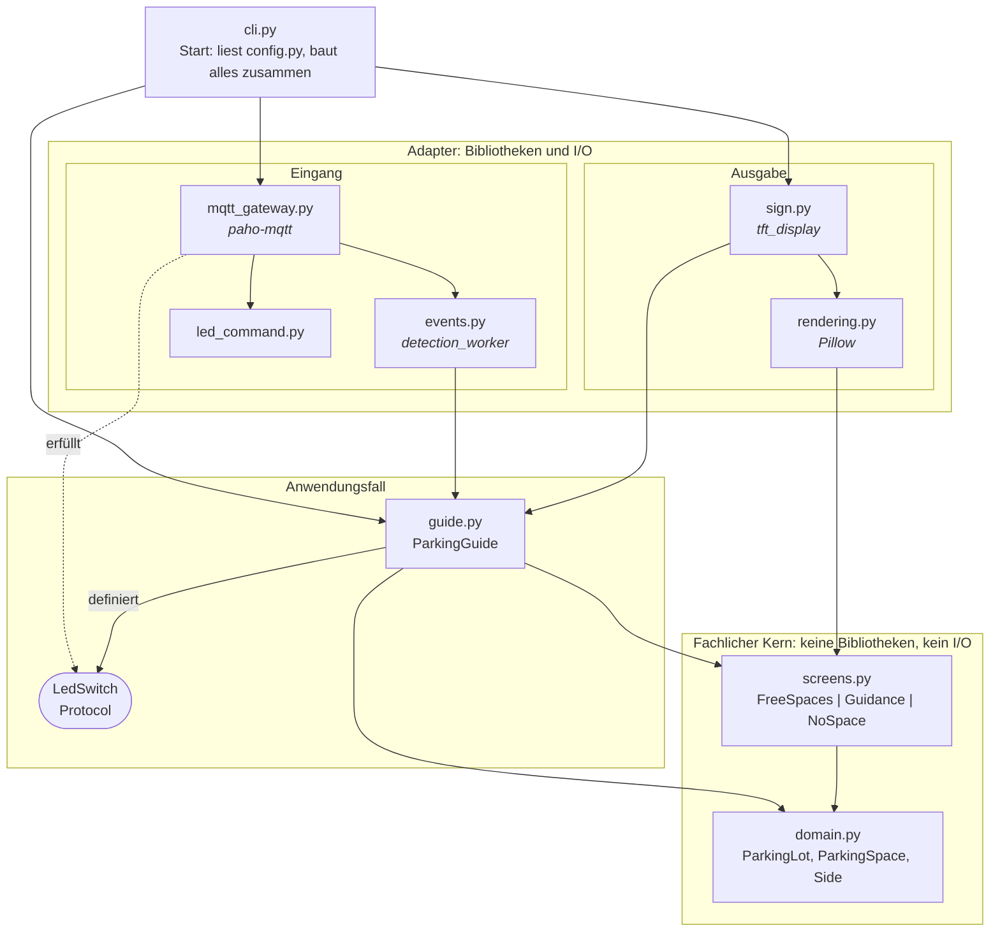
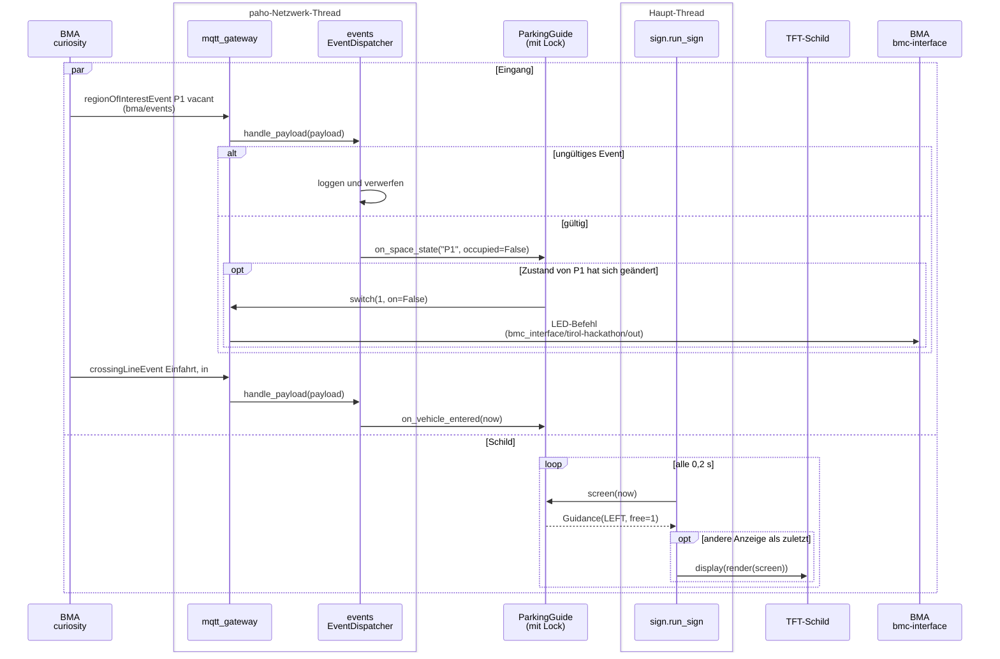

# Musterlösung: Parkleitsystem

Eine mögliche Lösung der Hackathon-Challenge. Fährt ein Auto über die
Einfahrt-Linie, zeigt das Schild an der Einfahrt einen **Pfeil nach links oder
rechts**, zur Seite mit den meisten freien Plätzen, und darunter, **wie viele
Plätze frei** sind. Ist kein Platz frei, zeigt es ein **rotes X**. Jeder
Parkplatz hat eine **LED**, die leuchtet, solange er belegt ist.

| Ruhe | Auto fährt ein | Auto fährt ein | Kein Platz frei |
| --- | --- | --- | --- |
| blaues „P“, „4 frei“ | grüner Pfeil ←, „3 frei“ | grüner Pfeil →, „1 frei“ | rotes X, „voll“ |

## Aufbau

```
                            Lego-Parkplatz
  ┌──────────────────────────────────────────────────────────────┐
  │   ┌────┐ ┌────┐                             ┌────┐ ┌────┐    │
  │   │ P1 │ │ P2 │   ◄── links       rechts ──► │ P3 │ │ P4 │    │
  │   └────┘ └────┘                             └────┘ └────┘    │
  │    LED1   LED2                               LED3   LED4     │
  │                 ════════ Einfahrt ════════                   │
  │                    (Crossing Line)     ▲ Auto                │
  └────────────────────────────────────────┼─────────────────────┘
       ▲ Kamera              ▲ Kabel zu     │ sieht das Schild
       │                     │ den LEDs     ▼
  ┌────┴───────────────┐  ┌──┴────────┐  ┌──────────────┐
  │ BMAv3              │  │ BMC       │  │ TFT-Schild   │
  │ G-A2610-0007       ├──┤ Kontakte  │  │ RB-TFT1.8    │
  │ ├─ curiosity       │  │ 1..10     │  └──────┬───────┘
  │ └─ bmc-interface   │  └───────────┘         │ SPI + 2 GPIO
  └────┬───────────────┘  seriell               │ (Steckkabel)
       │ eth0 169.254.42.1                      │
       │                          ┌─────────────┴──────────────┐
       └────── LAN-Kabel ────────►│ Raspberry Pi 5             │
                 169.254.42.3     │ hackathon.local            │
                                  │ ├─ Mosquitto (Port 1883)   │
                                  │ └─ parkleitsystem          │
                                  └─────────────┬──────────────┘
                                                │ WLAN
                                         Laptops der Teams
```

Über den MQTT-Broker auf dem Pi laufen zwei Nachrichtenarten:

```
 BMA (curiosity) ── bma/events ─────────────────────────► parkleitsystem
                    regionOfInterestEvent: Zone P1..P4 belegt/frei
                    crossingLineEvent:     Auto über "Einfahrt"

 parkleitsystem ─── bmc_interface/tirol-hackathon/out ──► BMA (bmc-interface)
                    LED-Befehl: Kontakt 1..4 ON/OFF
```

### Verdrahtung TFT ↔ Raspberry Pi

Ansicht von oben auf die 40-polige Stiftleiste, Pin 1 oben links. Nur die
ersten 24 Pins werden gebraucht. Details und Fehlersuche:
[doc/tft-display.md](../doc/tft-display.md).

```
                 links (ungerade)        rechts (gerade)
  TFT VCC ──►  3V3     ( 1) ●  ● ( 2)  5V
               GPIO 2  ( 3) ●  ● ( 4)  5V
               GPIO 3  ( 5) ●  ● ( 6)  GND        ◄── TFT GND
               GPIO 4  ( 7) ●  ● ( 8)  GPIO 14
               GND     ( 9) ●  ● (10)  GPIO 15
               GPIO 17 (11) ●  ● (12)  GPIO 18
               GPIO 27 (13) ●  ● (14)  GND
               GPIO 22 (15) ●  ● (16)  GPIO 23
               3V3     (17) ●  ● (18)  GPIO 24    ◄── TFT RES
  TFT SDA ──►  GPIO 10 (19) ●  ● (20)  GND
               GPIO 9  (21) ●  ● (22)  GPIO 25    ◄── TFT RS/DC
  TFT SCL ──►  GPIO 11 (23) ●  ● (24)  GPIO 8     ◄── TFT CS
```

VCC an **3,3 V**, nicht an 5 V.

## Starten

### Auf dem Raspberry Pi (mit Bildschirm)

Voraussetzung: SPI ist aktiviert (siehe
[doc/tft-display.md](../doc/tft-display.md#einrichtung-betreuer-einmalig)) und
uv ist installiert.

```bash
cd Tirol-Hackathon/Musterloesung
uv sync --extra pi
cp config.example.toml config.toml
```

Zugangsdaten für den Broker setzen (das Passwort wird nicht angezeigt und
landet nicht in der Shell-History):

```bash
read -rs MQTT_PASSWORD && export MQTT_USER=hackathon MQTT_PASSWORD
```

```bash
uv run parkleitsystem --config config.toml
```

Beenden mit **Strg+C**. Beim Beenden geht der Bildschirm aus.

### Auf dem Laptop (ohne Bildschirm)

In `config.toml` `host = "hackathon.local"` eintragen, dann:

```bash
uv sync
uv run parkleitsystem --config config.toml --preview schild.png
```

Statt auf das TFT wird das Schild nach jeder Änderung in `schild.png`
geschrieben. Öffnet die Datei in einem Bildbetrachter, der sie bei Änderungen
neu lädt.

## Konfiguration

Alles steht in `config.toml`, die Vorlage ist
[`config.example.toml`](config.example.toml). Die Namen müssen **genau** so
heißen wie im BMA (Groß-/Kleinschreibung zählt). Welche Namen ankommen, seht
ihr mit:

```bash
mosquitto_sub -h hackathon.local -u "$MQTT_USER" -P "$MQTT_PASSWORD" \
-t bma/events -v
```

| Abschnitt | Wichtig |
| --- | --- |
| `[entry]` | `line_name`: Name der Einfahrt-Linie (`lineName`); `guidance_seconds`: wie lange der Pfeil stehen bleibt; `vehicle_classes`: z. B. `["car"]`, damit eine Hand auf der Linie keinen Pfeil auslöst |
| `[[spaces]]` | ein Block pro Parkplatz: `roi_name` (Zone im BMA), `side` (`"left"`/`"right"`, vom Schild aus gesehen), `led_contact` (1–10) |
| `[leds]` | `team`: euer fester Teamname; die Spam-Sperre zählt pro Team |
| `[display]` | `rotation`, `x_offset`/`y_offset`, `bgr`, `invert`: so, wie es das Testbild aus `examples/tft_display_demo.py` ergibt |

Tippfehler fallen sofort auf: Unbekannte Schlüssel, doppelte Zonen oder
doppelte LED-Kontakte bricht das Programm beim Start mit einer Fehlermeldung
ab.

## Ohne BMA testen

In [`testdaten/`](testdaten) liegen Beispiel-Events für die Namen aus
`config.example.toml`. Bei laufendem Programm in einem zweiten Terminal:

```bash
mosquitto_pub -h hackathon.local -u "$MQTT_USER" -P "$MQTT_PASSWORD" \
-t bma/events -f testdaten/p1-frei.json
```

```bash
mosquitto_pub -h hackathon.local -u "$MQTT_USER" -P "$MQTT_PASSWORD" \
-t bma/events -f testdaten/einfahrt.json
```

Das Schild zeigt jetzt 10 Sekunden lang einen Pfeil nach links und „1 frei“.
Mit `testdaten/p1-belegt.json` geht LED 1 an und das Schild zeigt das X.

> Die anderen Teams bekommen diese Events auch. Ihre Programme sollten sie
> ignorieren, solange ihre Zonen anders heißen.

## Wie entscheidet das Programm?

- **Belegung:** Jede Zone meldet sich regelmäßig mit `occupied` oder `vacant`.
  Eine Zone, die sich noch nie gemeldet hat, zählt weder als frei noch als
  belegt. So wird kein Auto zu einem Platz geschickt, über den nichts bekannt
  ist.
- **LEDs:** Ein LED-Befehl geht nur raus, wenn sich der Zustand eines Platzes
  **ändert**. Die Zonen melden sich auch ohne Änderung alle paar Sekunden;
  jedes Mal zu senden, würde schnell die Spam-Sperre von bmc-interface
  auslösen.
- **Richtung:** Pfeil zur Seite mit den meisten freien Plätzen, bei
  Gleichstand nach links. Ändert sich die Belegung, während der Pfeil steht,
  dreht er sich mit.
- **X:** sobald kein Platz als frei bekannt ist, auch in Ruhe.

## Aufbau des Codes

Die Lösung folgt dem Prinzip der **Clean Architecture**: Der fachliche Kern
kennt weder MQTT noch Bildschirm, Bibliotheken und Ein-/Ausgabe hängen außen
an. Deshalb lässt sich der Kern ohne Hardware und ohne Broker testen.

### Schichten und Abhängigkeiten

Ein durchgezogener Pfeil heißt „importiert“. Alle zeigen **nach innen**
(hier: nach unten): Außen darf innen kennen, nie umgekehrt.



**Dependency Inversion bei den LEDs:** `guide.py` muss LEDs schalten, kennt
MQTT aber nicht. Es legt nur fest, was es braucht: das Protocol `LedSwitch`
mit einer Methode `switch(contact, on)`. `mqtt_gateway.py` erfüllt dieses
Protocol (gestrichelter Pfeil), ohne `guide.py` zu importieren. Im Test steht
an derselben Stelle ein einfacher Rekorder, der sich die Aufrufe merkt.

### Ablauf zur Laufzeit

Zwei Threads arbeiten gleichzeitig (`par`): paho empfängt Nachrichten in
seinem eigenen Netzwerk-Thread, der Haupt-Thread zeichnet das Schild. Beide
treffen sich im `ParkingGuide`, den ein Lock schützt. Das Beispiel: Platz P1
wird frei, dann fährt ein Auto ein.



- **Lock:** Ohne ihn könnte der Haupt-Thread die Belegung lesen, während der
  Netzwerk-Thread sie gerade ändert. Der LED-Befehl wird erst nach dem Lock
  gesendet, damit eine langsame Verbindung das Schild nicht aufhält.
- **Zeit als Parameter:** `guide.screen(now)` bekommt die Uhrzeit übergeben.
  Tests prüfen so „Pfeil verschwindet nach 10 s“, ohne 10 s zu warten.
- **Nur bei Änderung:** LEDs werden nur bei einem Zustandswechsel geschaltet,
  das Schild nur bei einer anderen Anzeige neu gezeichnet.

### Die Dateien

| Datei | Aufgabe |
| --- | --- |
| `domain.py` | Parkplätze, Belegung, Seite mit den meisten freien Plätzen |
| `screens.py` | die drei möglichen Anzeigen: `FreeSpaces`, `Guidance`, `NoSpace` |
| `guide.py` | reagiert auf Zonen und Einfahrten, schaltet LEDs, entscheidet die Anzeige |
| `events.py` | BMA-Events (über `detection_worker`) an den `guide` weiterreichen |
| `rendering.py` | Anzeige als 160 × 128-Bild zeichnen (Pillow) |
| `sign.py` | Anzeigeschleife: neu zeichnen, wenn sich etwas ändert |
| `led_command.py` | LED-Befehl im Format von [doc/leds-per-mqtt.md](../doc/leds-per-mqtt.md) |
| `mqtt_gateway.py` | eine MQTT-Verbindung: Events abonnieren, LED-Befehle senden |
| `config.py` | `config.toml` lesen und prüfen |
| `cli.py` | alles verbinden und starten |

Bausteine aus dem Hauptprojekt: `detection_worker` (Events lesen und verteilen)
und `tft_display` (Bildschirm).

## Entwickeln

```bash
uv run pytest
uv run ruff format .
uv run ruff check .
uv run pyright
```
