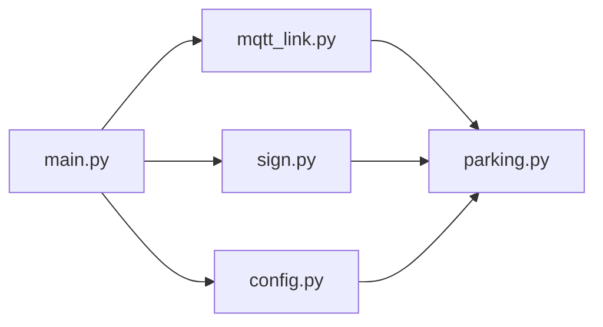

# Musterlösung: Parkleitsystem

Eine mögliche Lösung der Hackathon-Challenge. Fährt ein Auto über die
Einfahrt-Linie, zeigt das Schild an der Einfahrt einen **Pfeil nach links oder
rechts**, zur Seite mit den meisten freien Plätzen, und darunter, **wie viele
Plätze frei** sind. Ist kein Platz frei, zeigt es ein **rotes X**. Jeder
Parkplatz hat eine **LED**, die leuchtet, solange er belegt ist. Fährt ein
Auto ein, **blinkt die LED des empfohlenen Platzes**, bis das Auto dort steht
oder die Führungszeit (`guidance_seconds`) vorbei ist.

Ohne Schild (`[display] enabled = false`) laufen nur die LEDs; so ist der
Aufbau im Moment konfiguriert. Betrieb als Docker-Container auf dem Pi:
[deploy/parkleitsystem](../deploy/parkleitsystem/README.md).

| Ruhe | Auto fährt ein | Auto fährt ein | Kein Platz frei |
| --- | --- | --- | --- |
| blaues „P“, „4 frei“ | grüner Pfeil ←, „3 frei“ | grüner Pfeil →, „1 frei“ | rotes X, „voll“ |

## Aufbau

```
                            Lego-Parkplatz
  ┌──────────────────────────────────────────────────────────────┐
  │   ┌────┐ ┌────┐                             ┌────┐ ┌────┐    │
  │   │ P1 │ │ P2 │   ◄── links       rechts ──► │ P3 │ │ P4 │    │
  │   └────┘ └────┘                             └────┘ └────┘    │
  │    LED1   LED2                               LED3   LED4     │
  │                 ════════ Einfahrt ════════                   │
  │                    (Crossing Line)     ▲ Auto                │
  └────────────────────────────────────────┼─────────────────────┘
       ▲ Kamera              ▲ Kabel zu     │ sieht das Schild
       │                     │ den LEDs     ▼
  ┌────┴───────────────┐  ┌──┴────────┐  ┌──────────────┐
  │ BMAv3              │  │ BMC       │  │ TFT-Schild   │
  │ G-A2610-0007       ├──┤ Kontakte  │  │ RB-TFT1.8    │
  │ ├─ curiosity       │  │ 1..10     │  └──────┬───────┘
  │ └─ bmc-interface   │  └───────────┘         │ SPI + 2 GPIO
  └────┬───────────────┘  seriell               │ (Steckkabel)
       │ eth0 169.254.42.1                      │
       │                          ┌─────────────┴──────────────┐
       └────── LAN-Kabel ────────►│ Raspberry Pi 5             │
                 169.254.42.3     │ hackathon.local            │
                                  │ ├─ Mosquitto (Port 1883)   │
                                  │ └─ parkleitsystem          │
                                  └─────────────┬──────────────┘
                                                │ WLAN
                                         Laptops der Teams
```

Über den MQTT-Broker auf dem Pi laufen zwei Nachrichtenarten:

```
 BMA (curiosity) ── bma/events ─────────────────────────► parkleitsystem
                    regionOfInterestEvent: Zone P1..P4 belegt/frei
                    crossingLineEvent:     Auto über "Einfahrt"

 parkleitsystem ─── bmc_interface/tirol-hackathon/out ──► BMA (bmc-interface)
                    LED-Befehl: Kontakt 1..4 ON/OFF
```

### Verdrahtung TFT ↔ Raspberry Pi

Ansicht von oben auf die 40-polige Stiftleiste, Pin 1 oben links. Nur die
ersten 24 Pins werden gebraucht. Details und Fehlersuche:
[doc/tft-display.md](../doc/tft-display.md).

```
                 links (ungerade)        rechts (gerade)
  TFT VCC ──►  3V3     ( 1) ●  ● ( 2)  5V
               GPIO 2  ( 3) ●  ● ( 4)  5V
               GPIO 3  ( 5) ●  ● ( 6)  GND        ◄── TFT GND
               GPIO 4  ( 7) ●  ● ( 8)  GPIO 14
               GND     ( 9) ●  ● (10)  GPIO 15
               GPIO 17 (11) ●  ● (12)  GPIO 18
               GPIO 27 (13) ●  ● (14)  GND
               GPIO 22 (15) ●  ● (16)  GPIO 23
               3V3     (17) ●  ● (18)  GPIO 24    ◄── TFT RES
  TFT SDA ──►  GPIO 10 (19) ●  ● (20)  GND
               GPIO 9  (21) ●  ● (22)  GPIO 25    ◄── TFT RS/DC
  TFT SCL ──►  GPIO 11 (23) ●  ● (24)  GPIO 8     ◄── TFT CS
```

VCC an **3,3 V**, nicht an 5 V.

## Starten

### Auf dem Raspberry Pi (mit Bildschirm)

Voraussetzung: SPI ist aktiviert (siehe
[doc/tft-display.md](../doc/tft-display.md#einrichtung-betreuer-einmalig)) und
uv ist installiert.

```bash
cd Tirol-Hackathon/Musterloesung
uv sync --extra pi
cp config.example.toml config.toml
```

Zugangsdaten für den Broker setzen (das Passwort wird nicht angezeigt und
landet nicht in der Shell-History):

```bash
read -rs MQTT_PASSWORD && export MQTT_USER=hackathon MQTT_PASSWORD
```

```bash
uv run parkleitsystem --config config.toml
```

Beenden mit **Strg+C**. Beim Beenden geht der Bildschirm aus.

### Auf dem Laptop (ohne Bildschirm)

In `config.toml` `host = "hackathon.local"` eintragen, dann:

```bash
uv sync
uv run parkleitsystem --config config.toml --preview schild.png
```

Statt auf das TFT wird das Schild nach jeder Änderung in `schild.png`
geschrieben. Öffnet die Datei in einem Bildbetrachter, der sie bei Änderungen
neu lädt.

## Konfiguration

Alles steht in `config.toml`, die Vorlage ist
[`config.example.toml`](config.example.toml). Die Namen müssen **genau** so
heißen wie im BMA (Groß-/Kleinschreibung zählt). Welche Namen ankommen, steht
im Log des Programms (`docker logs parkleitsystem` bzw. im Terminal).

| Abschnitt | Wichtig |
| --- | --- |
| `[entry]` | `line_name`: Name der Einfahrt-Linie im BMA; `guidance_seconds`: wie lange die empfohlene LED blinkt (und der Pfeil steht) |
| `[[spaces]]` | ein Block pro Parkplatz: `name` (Zone im BMA), `side` (`"left"`/`"right"`, aus Sicht des einfahrenden Autos), `led` (BMC-Kontakt 1–10); die Reihenfolge ist die Priorität der Empfehlung |
| `[leds]` | `team`: euer fester Teamname; die Spam-Sperre zählt pro Team |
| `[display]` | `enabled`: `false`, solange kein Schild angeschlossen ist; `rotation`, `x_offset`/`y_offset`, `bgr`, `invert`: so, wie es das Testbild aus `examples/tft_display_demo.py` ergibt |

Tippfehler fallen sofort auf: Unbekannte Schlüssel, doppelte Zonen oder
doppelte LEDs bricht das Programm beim Start mit einer Fehlermeldung ab.

## Ohne BMA testen

In [`testdaten/`](testdaten) liegen Beispiel-Events für die Namen aus
`config.example.toml`. Bei laufendem Programm in einem zweiten Terminal:

```bash
mosquitto_pub -h hackathon.local -u "$MQTT_USER" -P "$MQTT_PASSWORD" \
-t bma/events -f testdaten/p1-frei.json
```

```bash
mosquitto_pub -h hackathon.local -u "$MQTT_USER" -P "$MQTT_PASSWORD" \
-t bma/events -f testdaten/einfahrt.json
```

Jetzt blinkt 10 Sekunden lang die LED des empfohlenen Platzes. Mit
`testdaten/p1-belegt.json` geht LED 1 an.

> Die anderen Teams bekommen diese Events auch. Ihre Programme sollten sie
> ignorieren, solange ihre Zonen anders heißen.

## Wie entscheidet das Programm?

- **Belegung:** Jede Zone meldet sich regelmäßig mit `occupied` oder `vacant`.
  Eine Zone, die sich noch nie gemeldet hat, zählt weder als frei noch als
  belegt. So wird kein Auto zu einem Platz geschickt, über den nichts bekannt
  ist.
- **LEDs:** Kontakt an = belegt, aus = frei. Die zweifarbigen LEDs am Aufbau
  zeigen damit frei in Grün. Ein Befehl geht nur raus, wenn sich der Zustand
  **ändert**: Die Zonen melden sich auch ohne Änderung alle paar Sekunden,
  jedes Mal zu senden würde die Spam-Sperre von bmc-interface auslösen.
- **Empfehlung:** Seite mit den meisten freien Plätzen, bei Gleichstand
  links; auf dieser Seite der erste freie Platz in der Reihenfolge der
  `[[spaces]]`-Blöcke. Seine LED blinkt (alle 0,5 s an/aus), bis das Auto dort
  steht oder `guidance_seconds` vorbei ist. Geblinkt wird mit
  `permanent`-Befehlen: Während ein `normal`-Impuls läuft, ignoriert
  bmc-interface `permanent`-Befehle, ein einparkendes Auto ließe die LED dann
  falsch stehen.
- **Verdrahtung:** In der hinteren Reihe sind die LEDs umgekehrt
  angeschlossen (Kontakt 6 hinter P10 … Kontakt 10 hinter P6), am 04.11.2026
  vor Ort durchgeschaltet. Das steht nur in `config.example.toml`, der Code
  weiß davon nichts.
- **Schild (optional):** Pfeil zur Seite mit den meisten freien Plätzen,
  darunter die Zahl freier Plätze; ein rotes X, sobald kein Platz frei ist.

## Aufbau des Codes

Fünf Dateien in [`src/parkleitsystem/`](src/parkleitsystem). Zum Lesen am
besten in dieser Reihenfolge:

| Datei | Aufgabe |
| --- | --- |
| [`parking.py`](src/parkleitsystem/parking.py) | **Die Logik:** Belegung, LEDs, Empfehlung, Blinken, was das Schild zeigt. Kein MQTT, keine Hardware. |
| [`mqtt_link.py`](src/parkleitsystem/mqtt_link.py) | Verbindung zum Broker: BMA-Events rein, LED-Befehle raus |
| [`main.py`](src/parkleitsystem/main.py) | Start: alles verbinden, Hauptschleife |
| [`config.py`](src/parkleitsystem/config.py) | `config.toml` lesen und prüfen |
| [`sign.py`](src/parkleitsystem/sign.py) | Schild zeichnen (nur mit TFT) |

Aus dem Hauptprojekt kommen `bmc_leds` (LED-Befehl bauen, auch für eure
eigenen Programme), `detection_worker` (Events lesen) und `tft_display`
(Bildschirm).



Alle Pfeile zeigen auf `parking.py`, keiner von dort weg: Die Logik kennt
weder MQTT noch Bildschirm. Deshalb lässt sie sich ohne Broker und ohne
Hardware testen (`tests/test_parking.py`).

Das geht so:

- **LEDs ohne MQTT:** `CarPark` bekommt beim Erstellen „irgendetwas mit einer
  Methode `switch(led, on)`“ (das Protocol `Leds`). Im Programm ist das
  `MqttLink`, im Test ein Rekorder, der sich die Aufrufe merkt.
- **Zeit als Parameter:** `tick(now=…)` und `screen(now=…)` bekommen die
  Uhrzeit übergeben. Tests prüfen so „blinkt alle 0,5 s“ und „hört nach 10 s
  auf“, ohne zu warten.
- **Zwei Threads, ein Lock:** paho empfängt Nachrichten in seinem eigenen
  Thread, die Hauptschleife ruft alle 0,1 s `tick` auf. Der Lock in `CarPark`
  verhindert, dass beide gleichzeitig die Belegung ändern. LED-Befehle werden
  erst nach dem Lock gesendet, damit eine langsame Verbindung nichts aufhält.

## Entwickeln

```bash
uv run pytest
uv run ruff format .
uv run ruff check .
uv run pyright
```
