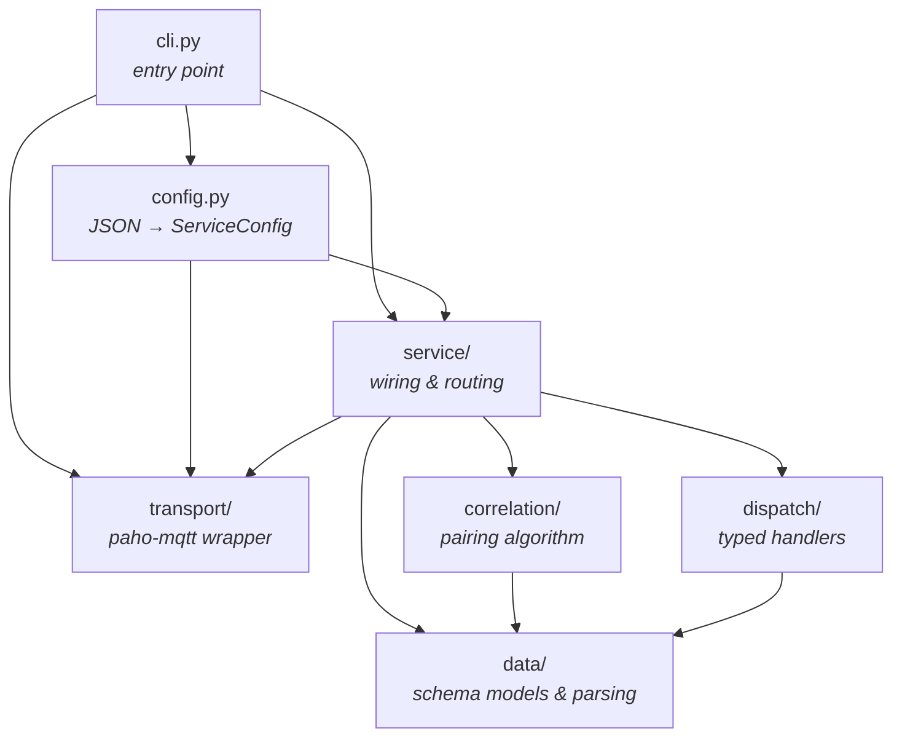
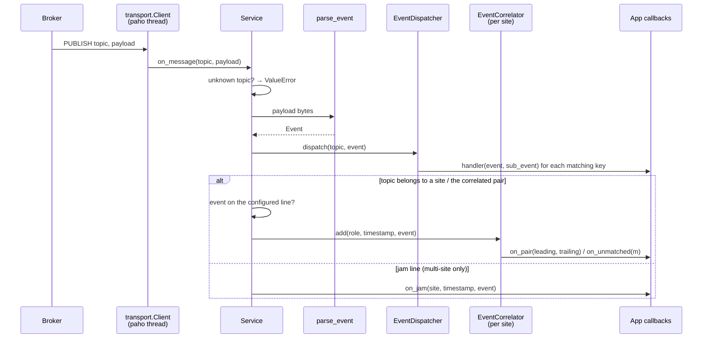
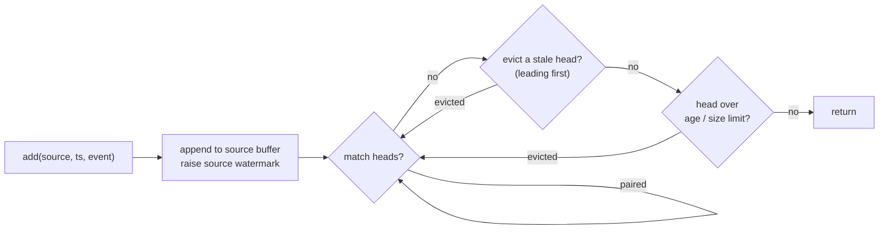
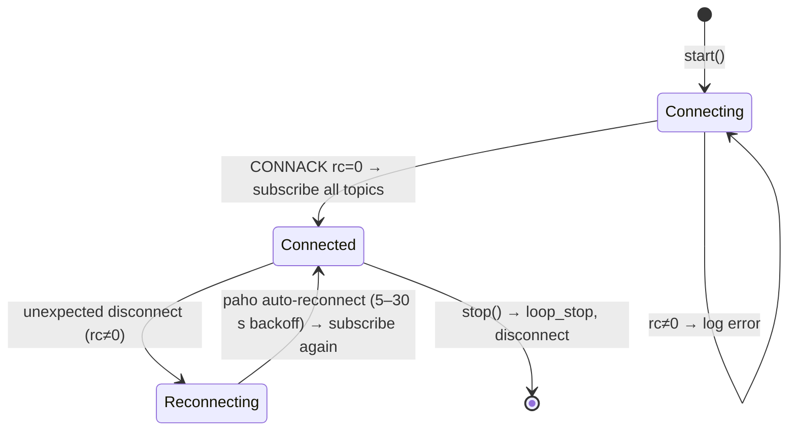

# detection_worker: Architecture

This document describes how `detection_worker` is built: its layers, how a
message flows through it, the threading model, and where to extend it. For
setup and usage examples, see [README.md](README.md).

## Purpose

Roadside devices publish Bernard event-schema 6.0 messages over MQTT. The
worker does two jobs:

1. **Correlation.** It pairs the events that two devices (typically a BMA
   hard-shoulder camera and a BCA ANPR camera) produce for the *same
   vehicle*, by timestamp proximity. Events that can't be paired are reported
   as unmatched.
2. **Dispatch.** It routes individual sub-events (a line crossing, a door
   pass, …) to typed handlers that the application registers per
   `(topic, name, event type)`.

## Layers

The package uses a layered design in which dependencies only point inwards.
The inner layers (`data`, `correlation`, `dispatch`) know nothing about MQTT,
threads, or configuration files, so they can be used and tested offline.

| Layer | Knows about | Responsibility |
| --- | --- | --- |
| `data` | nothing else | Dataclasses for the event schema (`Event` and its sub-events) and `parse_event`, which turns str / bytes / dict / zlib-compressed bytes into an `Event`. |
| `correlation` | `data` | `EventCorrelator[T]`: the generic, transport-agnostic pairing algorithm. `extract_timestamp`: picks the representative time of an `Event`. |
| `dispatch` | `data` | `EventDispatcher`: the `HandlerKey → handler` table and the `match`-based visitor over sub-event types. |
| `transport` | nothing else | `Client`: a thin paho-mqtt wrapper. `MqttClient`: the `Protocol` that services depend on. |
| `service` | all of the above | `CorrelatedEventService` (one topic pair) and `MultiSiteCorrelatedService` (many sites): connect callbacks, route messages, own the correlators. |
| `config`, `cli` | `service`, `transport` | Composition root: build a `Client` and a service from a JSON file and run it until it's stopped by a signal. |

`EventCorrelator` is generic over the event type `T`, so it can pair anything
that has a timestamp, for example plain strings in tests or recorded data in
notebooks.

### Dependency inversion at the transport boundary

Services depend on the `MqttClient` **protocol**, not on paho. The real
`Client` satisfies it structurally, and so does the in-memory
`tests/fake_mqtt_client.py`. That lets the service tests simulate a CONNACK
or deliver a message without a broker. Only `cli.py` (or your own startup
code) creates the concrete `Client`.

## Message lifecycle

Every MQTT message follows the same path. The diagram shows
`MultiSiteCorrelatedService`. The single-pair service is the same, minus the
line filtering and the jam route.

These rules hold throughout:

- **Dispatch comes first, and always happens.** Handlers see every parsed
  message on their topic, whether or not it then goes into correlation.
- **Only the configured line is correlated.** One topic can carry events for
  several virtual lines. `Site.line_name_*` / `line_type_*` choose which of
  them feed the correlator. Everything else on the topic only reaches the
  dispatcher.
- **Errors are contained at two levels.** `EventDispatcher` catches and logs
  exceptions per handler. `transport.Client` catches and logs exceptions per
  message, because paho would otherwise let one bad message end its network
  thread for good. A malformed payload costs that one message and nothing
  else.

## Correlation algorithm

`EventCorrelator` keeps one FIFO buffer of pending events per source, and a
**watermark** per source: the newest timestamp seen from that source.

- **Matching:** the head of the *leading* buffer is paired with the head of
  the trailing buffer when `0 ≤ trailing.ts − leading.ts ≤ tolerance`. With
  `symmetric=True` the condition becomes `−tolerance ≤ delay ≤ tolerance`.
  Matching is FIFO on both sides, not nearest-neighbour. Vehicles keep their
  order between two nearby devices, so FIFO is the more robust choice.
- **Eviction:** a head is flushed as unmatched once the *other* source's
  watermark proves it can't match any more. A leading head is evicted once the
  trailing watermark is more than `tolerance` past it. A trailing head is
  evicted once the leading watermark is past it at all (more than
  `tolerance` past it in `symmetric` mode).
- **Leading heads are evicted first.** A stale leading head can block the
  leading event that a trailing head would pair with. Once the stale one is
  gone, the new leading head either pairs with the trailing head or is
  provably too late for it. Evicting the trailing head first would lose that
  pair, depending only on which device happened to send its first event first.
  `tests/test_correlator.py` has a regression test for this.
- **Fixpoint:** matching and eviction alternate until neither makes progress.
  Evicting a stale head can make the next head pairable, and the loop finds
  that within the same `add` call.
- **Event time, not wall-clock time:** there are no timers, which makes the
  correlator deterministic and easy to test. A silent device never advances
  the watermark the other device's events wait on, so two limits bound the
  buffers anyway:
  - `max_pending_age` (default 5 min): an event is evicted once it's that much
    older than the newest event from its *own* device. This assumes one device
    never lags the other by more than that.
  - `max_pending` (default 10,000 per device): a hard cap. The oldest event
    is evicted beyond it, and a warning is logged.

  Both can be set to `None`. With the defaults, a one-device outage keeps
  about `max_pending_age` worth of events buffered. The rest are reported as
  unmatched continuously, rather than in one burst when the device comes back.
- **Buffers are `deque`s,** so evicting the oldest event takes the same time
  however long the buffer is.

`extract_timestamp` decides which time feeds the correlator. It prefers the
envelope's `timestamp`. Otherwise it uses the populated sub-event's own time:
the exit time for origin/destination events, the last path point for heatmap
events, or the first resolvable entry in `ruleEvents`.

## Dispatch design

The schema is a tagged union. Each `Event` populates exactly one sub-event
field, or a list of them inside `ruleEvents`. The dispatcher is the Python
version of a C++ `std::variant` handled with `std::visit`:

| Concept | Implementation |
| --- | --- |
| Variant | `SubEvent = CrossingLineEvent \| RegionOfInterestEvent \| ParkingEvent \| VirtualDoorEvent \| OriginDestinationEvent \| HeatmapEvent` |
| Visitor | `_names_of`: a `match` over the alternatives, ending in `assert_never`, so pyright fails if a new alternative isn't handled |
| Typed registration | `add_handler[T](key: HandlerKey[T], handler: Callable[[Event, T], None])`: pyright checks the handler's parameter type against `key.event_type` |
| Lookup | per sub-event, hash lookups of `HandlerKey(topic, name, type(sub))` for each of its names, plus `name=None` |

Lookup cost per message is a handful of dict lookups, independent of the
number of registered handlers.

`name` matches the sub-event's own name:

| Sub-event | Matched name(s) |
| --- | --- |
| `CrossingLineEvent` | `lineName` |
| `RegionOfInterestEvent` | `roiName` |
| `VirtualDoorEvent` | `virtualDoorName` |
| `OriginDestinationEvent` | entry zone name, exit zone name (deduplicated) |
| `ParkingEvent` | every `parkingSummary[].roiName` |
| `HeatmapEvent` | none; reachable only through `name=None` |

## Connection lifecycle

- **Subscribing on connect.** Subscriptions are made in the on-connect
  handler, never in `start()`. Sending SUBSCRIBE before the CONNACK breaks the
  protocol, and some brokers drop the connection for it. Doing it on every
  (re)connect is also what makes subscriptions survive automatic reconnects.
- **Subscribed topics.** The service subscribes to the union of its own
  topics and `dispatcher.topics`.
- **Backoff.** It is set to 5–30 s on purpose. A broker that still holds the
  session for a fixed client id rejects reconnects that come too fast, and
  paho's near-instant default turns that into a tight failure loop.
- **One connection for all sites.** `MultiSiteCorrelatedService` shares one
  `Client` across every site. The broker allows one live connection per
  client id, and a `Client` has only one `on_message` slot.

## Site config reload

`MultiSiteCorrelatedService.reload(sites)` updates the running service to
match a new site list without restarting it. Sites are compared by value
(`Site` is a plain dataclass):

| Change | Effect |
| --- | --- |
| Site unchanged | Left alone. Its correlator and the pending events it has buffered survive. |
| Site's fields changed | Unregistered and registered again from scratch. Its pending events are dropped, and there is no partial update of single fields. |
| Site added | Registered. Its topics are subscribed right away if the client is connected. |
| Site removed | Unregistered. Its topics are unsubscribed, *unless* a dispatcher handler still listens on them. |

Each topic belongs to at most one site. Registering a topic twice raises
`ValueError`, so sites can never correlate with each other.

## Threading model

- **Where callbacks run.** paho runs its network loop on a background thread
  started by `loop_start()`. All message handling runs on that one thread:
  parsing, dispatch, correlation and every application callback. The main
  thread only starts and stops the service; `cli.py` blocks in
  `signal.pause()`.
- **One lock per multi-site service.** Messages are processed one at a time on
  the network thread. `MultiSiteCorrelatedService` holds an `RLock` around
  message handling, connect/disconnect, and `reload()`. A reload from another
  thread (e.g. a config-change listener) waits for the message in progress,
  and the other way round. The lock is re-entrant, so a callback may call
  `reload()` itself.
- **Callbacks block the network loop.** Application callbacks run inline on
  the network thread. A slow handler delays every following message. Hand
  slow work (database writes, HTTP calls) off to a queue or executor.
- **`reload()` blocks behind slow callbacks.** Callbacks run under the lock,
  so a slow callback also delays a pending `reload()`.
- **Register handlers before `start()`.** Topics registered on the dispatcher
  after `start()` aren't subscribed until the next reconnect.

## Extension points

| You want to… | Do this |
| --- | --- |
| React to pairs or unmatched events | Pass `on_pair` / `on_unmatched` (and `on_jam` / `on_event` for multi-site). |
| Handle specific sub-events | Register handlers on an `EventDispatcher` and pass it as `dispatcher=`. |
| Support a new sub-event kind | Add the dataclass under `data/models/` and as an optional field on `Event` (and `RuleEvent` if it can be nested). `parse_event` then picks it up automatically from the type hints. In `dispatch/dispatcher.py`, add it to `SubEvent` and to `_populated`. pyright then flags the missing `case` in `_names_of`, but not a missing `_populated` entry. Add a branch to `extract_timestamp` if it should be correlatable. |
| Use another transport (Kafka, file replay, …) | Implement the `MqttClient` protocol, or feed `parse_event` + `EventCorrelator` / `EventDispatcher` directly. Neither depends on MQTT. |
| Load multi-site config from a file | Add a loader next to `config.load_config` that builds `MultiSiteServiceConfig`. |

## Testing strategy

- **Pure units:** these need no I/O and are tested directly.
  `tests/test_correlator.py` covers pairing, eviction (including the
  leading-first regression), and both buffer limits.
  `tests/test_event_dispatcher.py` covers dispatch. `parse_event` and
  `extract_timestamp` don't have tests of their own yet.
- **Services:** they're tested against `tests/fake_mqtt_client.py`, which
  records subscribe/unsubscribe/connect calls and lets tests trigger
  `on_connect` and `on_message` by hand.
- **CLI:** `run(config, client, wait)` takes the client and the blocking wait
  as parameters, so its start/stop and signal handling are tested without a
  broker or real signals.
