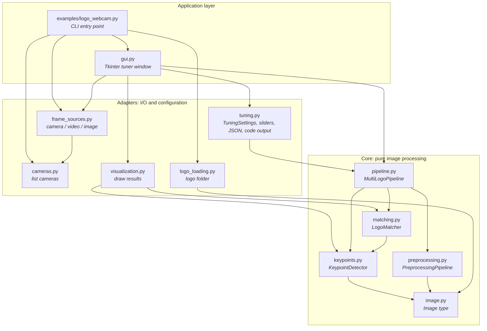
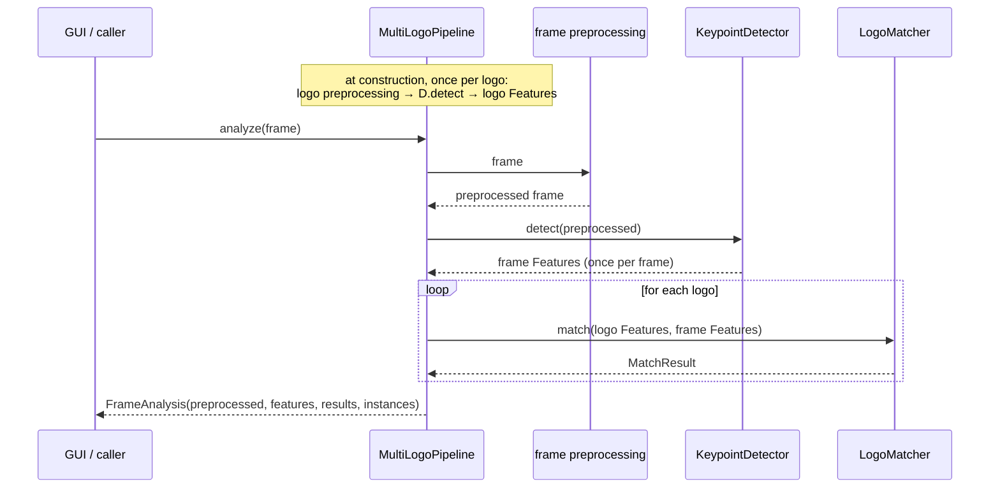
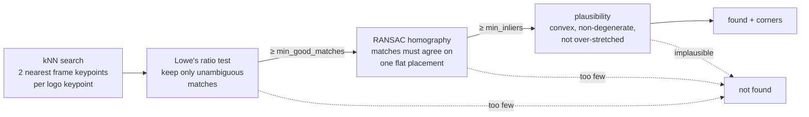

# picture_pipeline: Architecture

This document describes how `picture_pipeline` is built: its layers, what
happens to a frame, the design decisions behind the matching, and where to
extend it. For usage and parameters, see [README.md](README.md).

## Purpose

Given one or more static **logos** (reference images) and a stream of
**frames** (camera, video, still image), report for every frame and logo:

- **whether** the logo is visible, and
- **where**: its outline as a quadrilateral that follows rotation and
  perspective.

It uses classic keypoint matching with no training, so a new logo is just a
new image file. That keeps it usable on a Raspberry Pi CPU.

## Layers

Dependencies only point **downwards**, and the graph has no cycles:

| Layer | Modules | Knows about |
| --- | --- | --- |
| **Core** | `image`, `preprocessing`, `keypoints`, `matching`, `pipeline` | NumPy and OpenCV only. No files, cameras, GUI or configuration format. |
| **Adapters** | `visualization`, `logo_loading`, `cameras`, `frame_sources`, `tuning`, `live` | The core, plus one outside concern each: drawing, the file system, video devices, JSON/sliders, threads. |
| **Application** | `gui`, `examples/logo_webcam.py`, `examples/logo_viewer.py` | Everything. The only place that imports Tkinter or parses arguments. |

So the core can run unchanged in a headless service on a Pi, a notebook, a
test, or behind a different UI. Swapping the GUI never touches matching
code.

### Core modules

| Module | Responsibility |
| --- | --- |
| `image.py` | `Image = NDArray[uint8]`, the one image type every stage takes and returns. |
| `preprocessing.py` | `PreprocessingPipeline`: an ordered list of `Image → Image` steps. Plain functions, so any callable is a valid step. |
| `keypoints.py` | `KeypointDetector`: wraps SIFT / ORB / AKAZE / BRISK behind `detect(image) → Features`. `Features` carries the keypoints, the descriptors, the **distance norm** that compares them, and the source image size. |
| `matching.py` | `LogoMatcher.match(logo_features, frame_features) → MatchResult`. The four-stage filter described below. |
| `pipeline.py` | `MultiLogoPipeline` wires preprocessing → extraction → matching for many logos. `LogoDetectionPipeline` is its single-logo wrapper. |

## What happens to a frame

- **The expensive step runs once per frame.** Keypoint extraction on a
  full frame costs far more than matching against a few hundred logo
  keypoints. Extracting once and matching N times keeps the cost of adding
  logos small.
- **Logos are prepared once.** They're static, so their features are
  computed at construction. Changing a setting means building a new
  pipeline, which only re-processes the logos. That's cheap, and it's what
  the GUI does on every slider move.
- **One extractor for both sides.** SIFT descriptors are 128 floats compared
  by L2 distance; ORB/AKAZE/BRISK descriptors are bit strings compared by
  Hamming distance. Logo and frame features must come from the same
  extractor. `Features.norm_type` records which one, and the matcher refuses
  to mix them.
- **Separate preprocessing per side.** Logo files and camera frames differ:
  the logo is clean and high-resolution, the frame noisy and large. They
  can be preprocessed differently, as long as both reach the extractor in a
  comparable form (e.g. both grayscale).

## Matching: a funnel of four filters

`LogoMatcher` turns two sets of descriptors into a yes/no plus a location.
Each stage removes evidence that's likely wrong:

1. **kNN search** (`BFMatcher` exact, or `FlannBasedMatcher` approximate:
   KD-tree for float descriptors, LSH for binary ones). It always returns
   candidates, even when the logo is absent.
2. **Ratio test.** A match counts only if the nearest frame keypoint is
   clearly closer than the second nearest. This removes matches on
   repetitive or featureless texture.
3. **RANSAC homography.** Matches are judged *jointly*. True matches all
   follow one 3×3 projective transform, because the logo is flat. Chance
   matches in background clutter don't. This is the stage that separates
   "found" from "noise": in the tests, clutter never produced more than 2
   good matches and never enough inliers.
4. **Plausibility.** RANSAC can fit a transform to a few inliers clustered in
   one corner of the logo. That transform is accurate near those points but
   extrapolates wildly to the other corners. Such fits were measured: an ORB
   outline was off by 6,685 px. They're rejected because a real view of a
   flat logo is a convex quadrilateral with area whose opposite sides differ
   by at most `max_side_ratio`.

`MatchResult` keeps `good_matches` and `inliers` even when nothing is found,
so you can see which stage a detection failed at.

## Coordinate spaces

There are three image spaces:

| Space | Produced by | Used for |
| --- | --- | --- |
| original logo → **preprocessed logo** | logo preprocessing | `homography` maps *from* here |
| original frame → **preprocessed frame** | frame preprocessing | `corners`, `homography` *target*, `features` keypoints |
| **original frame** | the camera | what you usually want to draw on |

`MatchResult.frame_shape` and `Features.image_shape` record the
preprocessed frame's size. The drawing functions use them to scale back to
the original frame. That's well-defined only for uniform resizing. After a
crop (aspect ratio changed), they raise instead of drawing in the wrong
place. Resizing a *logo* never affects frame coordinates, because the outline
is projected from the preprocessed logo's own size.

## Configuration: one source of truth

`TuningSettings` (`tuning.py`) is a frozen dataclass of every tunable value.
Three things are derived from it, and they must never disagree:

- `build_pipeline(logos)`: the pipeline the GUI runs,
- `to_python()`: code reproducing that pipeline,
- `save()` / `load()`: JSON.

The preprocessing steps are described once, as a list of `(factory,
arguments)` pairs (`_frame_steps` / `_logo_steps`). `build_pipeline` calls
them, and `to_python` prints them. The printed code therefore can't drift
from what was tuned, and a test executes the printed code to confirm it.
`with_value` coerces raw widget values: it rounds integers, clamps to the
slider range, and makes the blur kernel odd. The GUI never has to validate
anything itself.

## GUI design

`gui.py` follows a **thin window, testable functions** split:

- `render(frame, analysis, …)` and `status_text(analysis, …)` are pure
  functions with unit tests.
- `LogoTunerApp` only wires widgets to `TuningSettings.with_value`, and
  repaints.

The window runs a **single-threaded loop** on Tk's `after()` timer, every
15 ms:

1. Read the next frame. A still image is re-processed only after a setting
   or view change.
2. If the settings changed, rebuild the pipeline. An invalid setting, e.g.
   a logo shrunk until it has no keypoints, shows a message and keeps the
   last working pipeline.
3. `analyze` → `render` → display, via PPM bytes into a `tk.PhotoImage`.
   This needs no Pillow dependency.

Processing runs on the GUI thread. While a frame is analyzed (tens of ms
with SIFT on a PC, more on a Pi), the window doesn't react. For a tuning tool
that's an acceptable trade-off for having no threading and no locking. A
production loop would run the pipeline without any GUI.

**Frame sources** (`frame_sources.py`) share one protocol: `read()`,
`release()`, `is_still`. `source_options` maps dropdown labels to *factories*,
so cameras are opened only when chosen: listing them doesn't switch every
camera on. `cameras.py` reads names from `/sys/class/video4linux` on Linux.
It skips each device's metadata nodes, which show up as extra `/dev/video*`
entries. On other systems it probes indices 0–4.

## Extension points

| You want to… | Do this |
| --- | --- |
| Add a preprocessing step | Write a function `Image → Image` and put it in a `PreprocessingPipeline`. For a GUI slider, add a field to `TuningSettings`, a `SliderSpec`, and an entry in `_frame_steps`/`_logo_steps`. |
| Add a keypoint extractor | Add a `DetectorKind` member and a `_DetectorSpec` (constructor and distance norm) in `keypoints.py`. The GUI dropdown and the tests that cover every extractor pick it up automatically. |
| Use a learned matcher (e.g. LightGlue, XFeat) | Write a second matcher class with the same `match(logo, frame) → MatchResult` interface. It replaces stages 1–2. Reuse stages 3–4, the RANSAC homography and plausibility check, unchanged. |
| Offload detection to a Hailo accelerator | Run a detector network on the Hailo to find candidate regions, then crop to them in frame preprocessing so the matcher only verifies and localizes. The core stays unchanged. Note the crop rule for drawing (see Coordinate spaces). |
| Run headless (service, Pi without display) | Use `MultiLogoPipeline` directly and skip `gui.py`. Nothing in the core imports Tkinter. |

## Testing strategy

- **Synthetic, deterministic data** (`tests/picture_fixtures.py`): a
  generated logo pasted into seeded clutter at a known position, rotation and
  scale. Because the true outline is known, tests check *where* a logo was
  found, not just *that* it was. That's how the ORB edge-keypoint bug was
  found: 35 presence-only tests had passed while ORB was misplacing the logo
  in 13 of 32 cases.
- **Grid tests:** SIFT must locate the logo across 8 rotations × 4 scales;
  every extractor must find an unrotated logo and raise no false alarm on
  logo-free clutter; every extractor/matcher combination must work.
- **Executable documentation:** the code printed by `to_python()` is run in
  a test, and the README examples were run against real image files.
- **Not covered:** the Tk window itself and real cameras. The window is kept
  thin for that reason; its drawing and status logic is tested directly.

## Known limitations

- **Synthetic numbers only.** The accuracy figures come from synthetic
  images; AKAZE and BRISK in particular may rank differently on real
  photographs. Tune on your own camera images.
- **Flat logos.** The homography assumes a flat logo; curved surfaces fit
  poorly.
- **One occurrence per logo and frame** is reported.
- **No tracking across frames:** each frame is judged on its own. For
  video, smoothing (e.g. "found in 3 of the last 5 frames") would reduce
  flicker; that would sit in the application layer.
